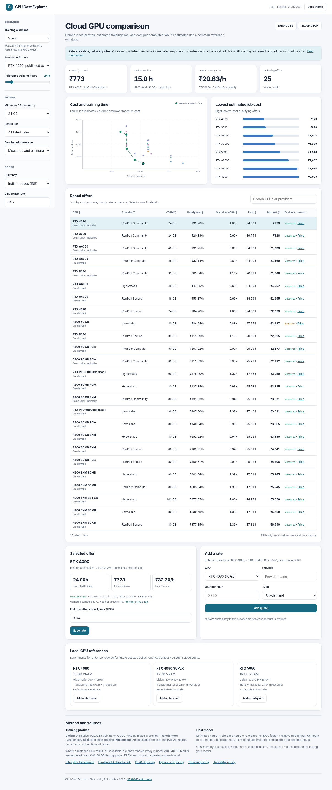

# GPU Cost Explorer

A static dashboard for comparing GPU rental prices, training performance, memory capacity, and estimated cost per completed job. It works in a browser without a backend, account, build tool, or third-party JavaScript dependencies.

**[Open the dashboard](index.html)** | [Methodology](docs/methodology.md) | [Free-credit research](docs/credits.md)



## Features

- Compare RunPod Community and Secure, Hyperstack, Thunder Compute, and Jarvislabs.
- Select **Vision**, **Transformer**, or **Multimodal** training profiles.
- Estimate completion time and compute cost from a configurable reference runtime.
- Filter by GPU memory, rental tier, and benchmark coverage.
- Inspect the cost-versus-time frontier and the lowest-cost qualifying offers.
- Edit an hourly rate, add a custom quote, or export the current comparison as CSV or JSON.
- Compare RTX 4080, RTX 4080 SUPER, and RTX 5080 as local workstation references without assigning them invented cloud rental prices.
- Switch between light and dark themes. **Light is the default.**

The dashboard uses a **fixed 2 November 2026 data snapshot**. It does not retrieve real-time rental availability or pricing. It does not claim that published benchmark throughput will match an individual model.

## Selected hardware

| GPU | VRAM | Main role in this comparison |
| --- | ---: | --- |
| RTX 4080 / RTX 4080 SUPER | 16 GB | Local workstation candidates; optional user-entered rental prices |
| RTX 5080 | 16 GB | Newer local workstation candidate; optional user-entered rental prices |
| RTX 4090 | 24 GB | Cost-focused cloud training when the model fits |
| RTX 5090 | 32 GB | Faster consumer GPU with more memory than the 4090 |
| A100 40 GB | 40 GB | Lower-cost A100 option where 40 GB is sufficient |
| RTX A6000 | 48 GB | Lower-cost high-memory cloud candidate |
| A100 80 GB PCIe / SXM | 80 GB | Larger-memory cloud candidate |
| H100 SXM | 80 GB | High-throughput comparison point, not the default recommendation |

The dashboard also includes a few larger GPUs to preserve context. The old GTX cards and other low-memory legacy GPUs are excluded from active paid comparisons. The T4 remains an optional **reference only**, not a quoted cloud rental.

## Compiled rental rates

These figures are **indicative rates per single GPU-hour**, not guaranteed deployable offers. Community rentals can vary by host, location, and capacity; dedicated instances can carry additional charges. User-adjusted quotes supersede these values only in the local browser.

| Provider and tier | RTX 4090 24 GB | RTX A6000 48 GB | A100 40 GB | A100 80 GB PCIe | Source |
| --- | ---: | ---: | ---: | ---: | --- |
| RunPod Community | $0.34 | $0.33 | Not listed | $1.19 | [RunPod](https://www.runpod.io/pricing) |
| RunPod Secure | $0.89 | $0.59 | Not listed | $1.79 | [RunPod](https://www.runpod.io/pricing) |
| Hyperstack on-demand | Not listed | $0.50 | Not listed | $1.35 | [Hyperstack](https://www.hyperstack.cloud/gpu-pricing) |
| Thunder Compute on-demand | Not listed | $0.35 | Not listed | $1.09 | [Thunder Compute](https://www.thundercompute.com/pricing) |
| Jarvislabs on-demand | Not listed | Not listed | ₹84.24 | ₹140.94 | [Jarvislabs India](https://jarvislabs.ai/in) |

Community prices represent advertised entry rates; verify them on the provider's selected pricing tier before purchase. For RunPod, the official pricing page initially displays Secure Cloud and requires switching to Community Cloud to compare lower-tier offers.

**Other listed rates:** Hyperstack A100 80 GB SXM $1.60/h; RunPod Secure A100 80 GB SXM $1.79/h; Thunder Compute H100 SXM $3.20/h; Jarvislabs H100 SXM ₹330.48/h. The complete editable starting dataset is in [`assets/data.js`](assets/data.js).

For INR display, the dashboard uses an editable reference rate of **$1 = ₹94.70** from 2 November 2026. It is not a live foreign-exchange feed.

## Published training results

Two public benchmark suites provide the basis for the performance profiles. They are **separate workloads** and their absolute numbers should not be compared across columns.

| GPU | YOLO26n, images/sec | MobileNetV3 BF16, sustained | DistilBERT BF16, sustained |
| --- | ---: | ---: | ---: |
| RTX 4080 | Not measured | 226.33 | 305.83 |
| RTX 4080 SUPER | Not measured | 215.50 | 322.97 |
| RTX 5080 | Not measured | 229.48 | 372.87 |
| RTX 4090 | **306.0** | 268.26 | **472.39** |
| RTX 5090 | 356.0 | 313.42 | 736.92 |
| RTX A6000 | 209.9 | Not included | Not included |
| A100 40 GB | Not included | Not included | Not included |
| A100 80 GB PCIe | 283.2 | 173.31 | 639.53 |
| A100 80 GB SXM | 286.8 | 175.17 | 690.91 |
| H100 SXM | 424.3 | 257.12 | 1291.98 |

Sources: [Ultralytics YOLO26n training](https://www.ultralytics.com/benchmarks) and [LynxBenchAI 26Q3 GPU results](https://www.technolynx.com/lynxbench-ai/training/). MobileNetV3 is used **only as a labeled cross-model ratio** for 4080-class cards absent from the YOLO table. The DistilBERT profile uses matched BF16 results where available. Numerical values are transcribed from those pages, not benchmarked by this project.

### Example: identical vision work

For an illustrative **10 million training-image presentations** on Ultralytics' YOLO26n workload, holding its published throughput constant:

| Rental choice | Images/sec | Estimated hours | Rental rate | GPU compute cost |
| --- | ---: | ---: | ---: | ---: |
| RunPod Community RTX 4090 | 306.0 | 9.08 | $0.34/h | **~₹292** |
| Thunder Compute RTX A6000 | 209.9 | 13.24 | $0.35/h | **~₹439** |
| Thunder Compute A100 80 GB | 283.2 | 9.81 | $1.09/h | **~₹1,012** |

This is a **normalized throughput example**, not a claim about time to reach identical model quality. The benchmark uses different auto-selected batch sizes, and the example excludes CPU, storage, network, tax, interruptions, and setup.

### A100 40 GB versus A100 80 GB

- The two variants have broadly similar theoretical compute capacity. The 80 GB variant has twice the GPU memory and more memory bandwidth.
- Jarvislabs lists **₹84.24/h** for A100 40 GB and **₹140.94/h** for A100 80 GB, a **67.3% hourly premium**.
- [DFKI's Pegasus cluster benchmark](https://pegasus.dfki.de/docs/slurm-cluster/partitions/) reports **326,000 versus 341,000 tokens/sec** for an eight-GPU Transformer training setup at a common TF32 batch setting, an approximately **4.6% throughput gain** for the 80 GB node. This is not a single-GPU benchmark and should not be transferred directly to different cloud instances.
- If a model trains comfortably within 40 GB, **40 GB is a strong price candidate**. For models that require more than 40 GB, the 80 GB card may be necessary even if it costs more.
- The dashboard uses **95.5% of corresponding 80 GB throughput** as a clearly labeled provisional 40 GB assumption, based on the above node-level ratio. It is not direct per-GPU evidence.

### RTX 4080 versus RTX 5080

LynxBenchAI's mixed-workload **training category scores** are 250.74 (4080), 247.68 (4080 SUPER), and 282.72 (5080). The RTX 5080 scores approximately **13% higher than the RTX 4080** on that index. The DistilBERT BF16 result is approximately **22% higher**. These cards all have **16 GB VRAM**, so the speed difference does not solve memory-limited training. The RTX 5080 is a newer local-build option, while a well-priced used 4080 can still be economical.

## Profiles and calculation

The relative performance baseline is the **RTX 4090**, not the T4:

- **Vision:** `YOLO26n images/sec ÷ RTX 4090 YOLO26n images/sec`, or a labeled cross-model proxy where missing.
- **Transformer:** `DistilBERT BF16 sustained score ÷ RTX 4090 DistilBERT BF16 score`, or a labeled assumption where missing.
- **Multimodal:** a *modeled runtime mixture* of Vision and Transformer work. A 60% Vision share and 40% Transformer share is the default. Its speed ratio is the weighted harmonic mean of the two ratios. This is **not a published multimodal benchmark**.

For any profile:

```text
reference_hours_on_4090 = reference_hours / t4_factor    (if T4 selected)
estimated_gpu_hours = reference_hours_on_4090 / relative_speed
estimated_billed_hours = estimated_gpu_hours * (1 + extra_time_percent / 100)
estimated_total_usd = estimated_billed_hours * hourly_price_usd + fixed_cost_usd
```

The optional T4 conversion factor defaults to **6×** and is **only a working assumption**. The most defensible comparisons use the same published benchmark reference and RTX 4090 runtime. See the [full methodology](docs/methodology.md) for evidence limitations and treatment of missing results.

## Use locally

Open [`index.html`](index.html) in a current browser. All CSS, JavaScript, and data files are in `assets/`. No package installation is needed.

For a local static server, if preferred:

```bash
python -m http.server 8000
```

Then open `http://localhost:8000`.

## Publish with GitHub Pages

1. Create an empty public repository on GitHub, for example `gpu-cost-explorer`.
2. Upload all files from this directory, preserving the `assets/` and `docs/` folders.
3. In **Settings > Pages**, select **Deploy from a branch**, then choose `main` and `/ (root)`.
4. Visit the URL shown by GitHub Pages when deployment completes.

Or use Git locally:

```bash
git init
git add .
git commit -m "Initial GPU cost explorer"
git branch -M main
git remote add origin https://github.com/YOUR-USERNAME/gpu-cost-explorer.git
git push -u origin main
```

Replace `YOUR-USERNAME` with your account name. Choose a license before granting redistribution rights. No repository is created automatically by these instructions.

## Updating the dataset

Edit the GPU and offer records in [`assets/data.js`](assets/data.js). Update the snapshot date in both `data.js` and `index.html`, then update this README. Retain source URLs and state clearly whether each speed value is measured or estimated. Published rates should be checked against the provider before being used in a procurement decision.

This project is independent of the GPU providers and benchmark publishers listed here. No hardware was rented or tested for this release.
